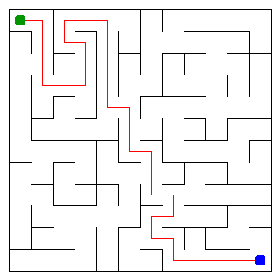

# Assignment 3. Maze Escape

Student ID: 251251  
Name: Eraly Rempel  
Group: SE-2512  
Maze size (rows x columns): 12 x 12

This project implements the assignment algorithms in Java 17 or newer. The code uses only the Java standard library; there are no graph or DSU libraries.

## Personal files

The files in `data` were generated for student ID 251251. To regenerate them from this project folder:

```bash
java tools/MakeVariant.java 251251 data
javac -d out src/*.java
java -cp out Main
```

The generator replaces the two files in `data`. After regeneration, rerun `Main` and `java tools/Check.java`.

## Program output

These numbers are from the personal files for ID 251251.

```text
Broken: 143
Kept: 121
Last broken wall: 195
MST cost: 38948
Heaviest broken wall: 669
Path length: 32
DFS visited: 91
Dead ends: 37
Zones: 11
Largest zone: 22
Is DAG: 0
Flow stages: 6
Fastest route cost: 19
```

## My maze

The image below was generated from the personal files for ID 251251.



Open `output/maze.html` in a browser to walk through the maze. Use the arrow keys or W/A/S/D. The checkboxes show cell numbers, wall costs, the DFS path, strongly connected zones, and slides.

## Questions

### Mission 0. What do `find` and `union` do, and what makes them fast?

`find` follows parent links until it reaches the root of a cell's group. On the way, it skips every second parent, so later searches are shorter. `union` joins two different groups and attaches the smaller group to the larger one.

### Mission 1. Why is `Broken` always R*C - 1, and `Kept` always (R-1)*(C-1)?

A maze has `R*C` cells, and a connected tree needs exactly one fewer edge than vertices, so `Broken` is `R*C - 1`. The total number of inner walls is `R*(C-1) + C*(R-1)`; subtracting the broken walls gives `(R-1)*(C-1)` walls that stay.

### Mission 2. My MST cost from Kruskal and Prim, and why are they equal

For my maze, both algorithms give an MST cost of **38948**. Kruskal checks all walls from cheapest to most expensive. My Prim starts at cell 0 and repeatedly takes the cheapest wall leading to a new cell. Both build a minimum spanning tree, so their total cost is equal.

### Mission 3. Why is there exactly one path between two cells? How did you avoid a stack overflow on a huge maze?

Mission 1 breaks a wall only when it connects two different components. The result is connected and has no cycles, so there is exactly one path between any two cells. The DFS uses an explicit array stack instead of recursive method calls, so a large maze does not overflow the Java call stack.

### Mission 4. Why does the second pass of Kosaraju go on the reversed graph? Why do the slides have no cycle exactly when Zones equals the number of cells?

The first DFS records cells in finishing order. The second DFS follows reversed slides in decreasing finishing order, which separates the strongly connected components correctly. If there is no directed cycle, every component has one cell; if any component has more than one cell, those cells belong to a cycle, so `Zones` is smaller than the number of cells.

### Mission 5. Why is the zone order enough, and what does this pass cost?

Kosaraju numbers the zones in topological order, so every slide between zones goes from a smaller number to a larger one. I first group the slides by their starting zone, then process the zones in number order to update the longest chain and cheapest route. This takes `O(n + s)` time, where `n` is the number of cells and `s` is the number of slides.

## AI use

I used ChatGPT to understand the algorithms, help implement path halving in DSU, Prim with a queue of walls, and the route pass grouped by zone, and check the program on the three provided examples. Before submitting, I will review the code and make sure I can explain every method.

## Timing (Mission 7)

These are five-run average timings measured with Java 25 in the current execution environment. Runtime depends on the computer and Java environment.

| Maze | Kruskal average (ms) | Prim average (ms) |
|---|---:|---:|
| 100 x 100 | 33 | 15 |
| 300 x 300 | 143 | 128 |
| 1000 x 1000 | 1991 | 3135 |

Both algorithms take longer as the maze grows because there are many more cells and walls to process. On the largest maze, Prim was slower in these runs; exact times vary with hardware and JVM behavior.

## Complexity

Here, `n` is the number of cells, `m` is the number of walls, and `s` is the number of slides. `α(n)` is the inverse Ackermann function, which grows extremely slowly.

| Algorithm | Time | Space | Assumptions |
|---|---|---|---|
| DSU `find` / `union` | `O(α(n))` amortized per operation | `O(n)` | Path compression and union by size |
| Kruskal | `O(m log m)` | `O(n + m)` | Sorting the walls dominates; the graph is connected |
| Prim | `O(m log m)` | `O(n + m)` | Priority queue of walls; the graph is connected |
| DFS escape | `O(n + m)` | `O(n + m)` | Iterative DFS; graph is built from the broken walls |
| Kosaraju | `O(n + s)` | `O(n + s)` | Two iterative DFS passes on the slide graph and its reverse |
| Route in the zone graph | `O(n + s)` | `O(n + s)` | Slides are grouped by starting zone; zones are in topological order |

